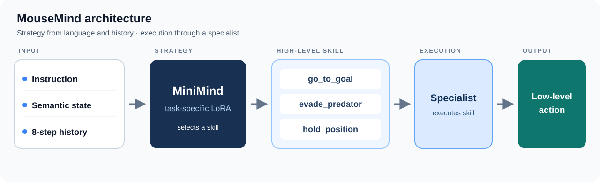

# MouseMind

**Counterfactual post-training for hierarchical control.**

MouseMind studies how a compact language model can make strategic decisions in the Cellworld BotEvade simulator. Exact-state counterfactual rollouts compare alternative skills, producing supervision for LoRA SFT and preference pairs for DPO. A 64M-class MiniMind planner reads an instruction, semantic state, and eight steps of history, then selects `go_to_goal`, `evade_predator`, or `hold_position`. Task-specific controllers turn that decision into movement.

The complete system combines a DPO-trained skill planner with task-specific controllers, including continuous behavior cloning for goal execution. On **200 held-out final seeds**, MouseMind achieves **97.5% task success and 41.5% capture-free success**, with **5.275 captures per episode**. The [final report](mouse_llm/continuous/LEGACY_HYBRID_FINAL_RESULTS.md) documents the evaluation protocol and component comparisons.

## Core idea



The diagram shows how verified outcomes train the skill-planner adapter within the hierarchy.

MiniMind decides which skill to use; the specialist decides how to execute it. The main planner follows the **counterfactual supervision → LoRA SFT → verified DPO** training path. DPO starts from a seed-isolated SFT skill-planner adapter and uses a frozen copy of that adapter as its reference, while the MiniMind backbone remains frozen.

At inference, the planner emits one of three constrained JSON skill responses. A continuous BC specialist executes GO as an `(x, y)` destination, while task-specific controllers handle EVADE and HOLD. This interface separates strategic decisions from geometric movement.

## Why hierarchy?

One-step action imitation does not directly optimize closed-loop outcomes. The hierarchy separates semantic and temporal skill selection from movement execution. Counterfactual supervision lets the planner learn from the measured consequences of alternative skills, while low-level controllers handle movement execution.

## Data and supervision

```text
118,861 simulator transitions → strict validation → 4,916 reconstructed episodes
                             → episode-isolated train/val/test splits
                             → serialized-prompt deduplication
```

The source trajectories are a legacy BotEvade simulator-policy export. The goal specialist learns from these trajectories; high-level targets come from verified, exactly replayable anchor states. For each preference, the pipeline executes candidate skills from the same state, scores their short-horizon outcomes, and builds SFT targets and chosen/rejected preference pairs.

The planner-training collection contains **320 anchors** and **1,920 verified counterfactual branches** at horizons **4 and 8**. The DPO study regroups anchors by collection seed and retrains its SFT initialization on the same **1,072 chosen responses** used for preference training. See the [technical guide](mouse_llm/README.md) for observation contracts and the [DPO report](VERIFIED_DPO_RESULTS.md) for the controlled training comparison.

## Planner post-training results

In the original controlled planner study, verified LoRA DPO improved task success from **92% to 100%** and capture-free success from **8% to 22%** relative to its own seed-isolated SFT initialization, with the same specialist. That study used a different 100-seed contract, and multiple DPO settings were evaluated on its fixed test pool. Its results are exploratory and are kept separate from the final 200-seed system evaluation below.

<details>
<summary>Historical 100-seed benchmark, ablations, and training comparisons</summary>

All rows use the same 100 paired BotEvade final-ID seeds, excluded from training. Multiple variants were evaluated on this fixed pool, so the comparison is exploratory rather than a one-shot blind test. Task success means reaching the goal; clean success additionally requires no capture; capture rate is the share of episodes with at least one capture. The numeric planner is a **non-language upper reference**. The published SFT LoRA is the main SFT result; Verified DPO was initialized from a separately retrained seed-isolated SFT LoRA, detailed in the [DPO report](VERIFIED_DPO_RESULTS.md).

| Policy | Planner training | Task success ↑ | Clean success ↑ | Capture rate ↓ | Captures / episode ↓ |
| --- | --- | ---: | ---: | ---: | ---: |
| Direct MiniMind | Flat action LoRA | 26% | 1% | 99% | 98.60 |
| Direct MLP BC | Flat action imitation | 20% | 5% | 94% | 87.90 |
| P1 rule hierarchy | Rule baseline | 79% | 14% | 86% | 11.20 |
| MiniMind without history | Hierarchical LoRA ablation | 80% | 1% | 99% | 13.15 |
| MiniMind without instruction | Hierarchical LoRA ablation | 80% | 1% | 99% | 13.15 |
| **Published MiniMind hierarchy** | **SFT LoRA · lower resource** | **97%** | **12%** | **88%** | **7.37** |
| Full-parameter MiniMind hierarchy | Full SFT, seed-isolated data | 95% | 18% | 82% | 5.41 |
| **Verified DPO skill planner, β=0.1** | **SFT LoRA → DPO LoRA · best language planner** | **100%** | **22%** | **78%** | **4.94** |
| Verified DPO skill planner, β=0.1 | Full SFT → full DPO | 80% | 1% | 99% | 13.09 |
| Verified GRPO skill planner | SFT LoRA → GRPO LoRA | 80% | 1% | 99% | 13.15 |
| Verified GRPO skill planner | Full SFT → full GRPO | 85% | 1% | 99% | 11.62 |
| Numeric planner | Non-language upper reference | 100% | 38% | 62% | 2.66 |

**Why use LoRA DPO for the main result?** It keeps the same MiniMind → skill → specialist hierarchy and continues training a seed-isolated SFT LoRA with exact-state verified preference pairs. Against its own SFT initialization (92% task success, 8% clean success, 92% capture rate, 8.94 captures per episode), task success improves by 8 percentage points, clean success by 14 points, capture rate falls by 14 points, and captures per episode fall by 4.00. The paired 95% confidence intervals for all four changes exclude zero. The published SFT LoRA above is a matched-evaluation historical reference, not DPO's initialization. LoRA DPO reaches the best tested combination of task completion and capture reduction among the language planners; the numeric reference remains stronger on clean success and captures.

**Why keep published LoRA SFT as the resource-conscious option?** It needs only the SFT stage and trains 393,216 skill-planner parameters (0.62% of MiniMind's 63,912,192). Its adapter checkpoint is about 0.8 MB versus about 275 MB for a full checkpoint; fewer trainable parameters also reduce optimizer-state storage. It achieves 97% task success, 12% clean success, and 7.37 captures per episode, while LoRA DPO provides the stronger measured safety result after an additional preference-training stage. The separately retrained seed-isolated SFT baseline remains in the detailed reports for a valid controlled DPO comparison.

Full-parameter DPO and GRPO both drift toward `evade_predator`: it occupies 99.8% and 97.4% of final-ID executed skill steps, respectively, versus 86.7% for full SFT and 68.0% for LoRA DPO. That observed shift accompanies lower task success and more captures; it is a plausible explanation, not proof of a unique cause. See [Verified DPO results](VERIFIED_DPO_RESULTS.md) for paired LoRA estimates, [full-parameter experiment](FULL_FINETUNE_EXPERIMENT.md) for the new run, [P2 results](P2_RESULTS.md) for original ablations and OOD, and [Verified RLVR summary](VERIFIED_ALIGNMENT_RESULTS.md) for the earlier GRPO and longer-training runs.

</details>

## Final system performance

The final system was selected on a separate 80-seed development pool, then frozen before evaluation on **200 held-out BotEvade seeds**. It uses the DPO-trained planner and the execution interface described above. Task success means reaching the goal; capture-free success additionally requires zero captures throughout the episode. Multiple captures can occur in one episode.

| Metric | Final system · 200 seeds |
| --- | ---: |
| Task success ↑ | **97.5% (195/200)** |
| Capture-free success ↑ | **41.5% (83/200)** |
| Captures / episode ↓ | **5.275** |

These results describe the complete hierarchy with fixed checkpoints in one simulator world. The SFT-to-DPO study above evaluates planner training; the ablations below evaluate execution choices under the frozen planner. Full paired intervals and checkpoint provenance are recorded in the final report.

[Final protocol](mouse_llm/continuous/LEGACY_HYBRID_FINAL_PROTOCOL.md) · [Final results](mouse_llm/continuous/LEGACY_HYBRID_FINAL_RESULTS.md)

## Implementation and ablations

### Skill execution

The goal executor maps observations to a continuous `(x, y)` request using a BC specialist. EVADE and HOLD use the existing task-specific controllers. The shared environment layer projects or rejects infeasible destinations. For compatibility with the planner's existing action-history format, the requested GO destination is mapped to its nearest catalog ID for history only; execution retains the continuous XY request.

### Executor ablation with a frozen DPO planner

To evaluate the execution layer, we kept the DPO weights, three-skill JSON interface, semantic context, planning cadence, and EVADE/HOLD controllers fixed, and replaced only the catalog-based GO MLP with continuous BC and its history adapter. The high-level planner was not retrained. All three systems below ran on the same 200 paired final seeds, sequentially on one H100 with a common simulator, navigation/reset contract, and software environment.

| System | Task success ↑ | Capture-free success ↑ | Captures / episode ↓ |
| --- | ---: | ---: | ---: |
| DPO planner + original discrete executor | 92.5% (185/200) | 18.5% (37/200) | 7.535 |
| Continuous BC alone | 96.0% (192/200) | 11.0% (22/200) | 3.780 |
| **DPO planner + continuous BC GO executor** | **97.5% (195/200)** | **41.5% (83/200)** | **5.275** |

The executor change produced paired 95% bootstrap intervals of **+23 pp [14, 31.5]** for capture-free success, **+5 pp [1, 9.5]** for task success, and **−2.26 [−4.20, −0.285]** for captures per episode relative to the original executor. The candidate passed all three predeclared criteria: improved capture-free completion, task noninferiority within 2 percentage points, and no increase in captures. These deltas describe execution refinement under fixed DPO weights, not a new DPO training gain.

Compared with direct BC, the hierarchy achieves more capture-free completions but has a higher mean capture count across all episodes: **5.275 versus 3.780**. This comparison adds the planner, skill switching, and EVADE/HOLD controllers together, so it does not isolate the effect of language reasoning. The intervals cover environment-seed variation for fixed checkpoints, not training-run variability. See the [development comparison](mouse_llm/continuous/LEGACY_HYBRID_EXPERIMENT.md) for candidate selection and the [final report](mouse_llm/continuous/LEGACY_HYBRID_FINAL_RESULTS.md) for the complete evidence.

### Instruction and history ablations

The historical skill-planner study measured **25% offline skill accuracy** without task LoRA and **62.2% on unseen paraphrases** after task adaptation. Removing instruction or temporal history reduced the historical hierarchy's closed-loop task success from **97% to 80%**. These ablations support the role of task adaptation and temporal context under that study's contract; they have not been rerun with the latest continuous executor.

## Engineering contributions

- Exact-state counterfactual branching for outcome-based SFT labels and preference pairs.
- Seed-isolated LoRA SFT/DPO with the SFT adapter retained as the frozen DPO reference.
- Semantic state, eight-step history, and constrained three-skill JSON decoding.
- A modular continuous goal executor that preserves the trained planner interface.
- Frozen evaluation contracts, paired seeds, checkpoint hashes, and reset/replay checks.
- Slurm execution with hardware provenance, resource measurements, and private artifact handling.

## Quick start

Install the project and environment dependencies from a checkout, then run the public synthetic demo:

```bash
python -m pip install -e '.[env]'
python demo.py
```

The demo exercises the evaluation path and action catalog; it does not reproduce the research results. Full BotEvade evaluation requires separately stored model checkpoints and the Cellworld cache. Set `CELLWORLD_CACHE`, `MOUSE_XY_SPECIALIST` (commanded-destination continuous BC), `MOUSE_LLM_BASE_WEIGHT`, `MOUSE_P2_SKILL_LORA_WEIGHT` (verified DPO β=0.1), and a private `MOUSE_XY_OUTPUT_ROOT` before running:

```bash
python -m mouse_llm.continuous.evaluation \
  --policy legacy-minimind-continuous-bc \
  --specialist-checkpoint "$MOUSE_XY_SPECIALIST" \
  --base-weight "$MOUSE_LLM_BASE_WEIGHT" \
  --skill-lora-weight "$MOUSE_P2_SKILL_LORA_WEIGHT" \
  --tokenizer model --device cuda --reuse-environment \
  --contract mouse_llm/continuous/experiments/legacy_hybrid_final_v1.json \
  --seed-pool development --world 21_05 --max-steps 300 \
  --time-step 0.25 --predator-speed-ratio 0.15 --max-line-of-sight-distance 1.0 \
  --destination-mode project --projection-epsilon 0.01 \
  --planner-horizon 8 --memory-steps 8 --evade-distance 0.35 \
  --preference survival_first --instruction-split train --planner-decoding greedy_trie \
  --action-catalog mouse_llm/envs/mice/assets/action_catalog_21_05.json \
  --output-dir "$MOUSE_XY_OUTPUT_ROOT/development-hybrid"
```

This command uses development seeds for checking the setup. The published final results use the registered 200-seed `final_id_test` pool; those outcomes are already known and must not be reused for candidate selection. The [frozen contract](mouse_llm/continuous/experiments/legacy_hybrid_final_v1.json) preserves the actual 0.01 projection inset used in the completed comparison. The general experimental default is different, so use this explicit contract when reproducing this configuration.

See the [continuous workflow](mouse_llm/continuous/RUNBOOK.md) for training and evaluation entry points, and the [P2 runbook](mouse_llm/northwestern/p2/RUNBOOK.md) for the historical planner benchmark. Private trajectories, per-episode records, and weights are not included in Git.

## Repository structure

| Path | Purpose |
| --- | --- |
| `mouse_llm/data` | Trajectory validation, episode reconstruction, and counterfactual skill labels. |
| `mouse_llm/hierarchical` | Semantic context, skill planning, and legacy execution. |
| `mouse_llm/continuous` | Continuous specialists, planner adapters, versioned navigation, and paired evaluation. |
| `mouse_llm/baselines` | Direct action and numeric planner baselines. |
| `mouse_llm/evaluation` | Historical offline, alignment, and closed-loop evaluation. |
| `mouse_llm/training` | Task-specific planner and specialist training. |
| `mouse_llm/verified_rl` | Utility reward, exact-state branching, and GRPO experiments. |
| `model` / `trainer` | MiniMind architecture, tokenizer, and base training utilities. |

## Limitations and retained findings

- The latest result covers fixed checkpoints in one simulator world; cross-map and training-seed generalization remain unmeasured for this executor.
- The continuous hierarchy trades higher capture-free completion for more captures per episode than direct BC.
- The historical numeric planner was stronger on capture-free success and captures under the historical contract. It was not evaluated in the latest final200 comparison.
- The three-skill vocabulary and low-level controllers are task-specific. Historical unseen-language and transfer evaluations expose substantial weaknesses.
- Full-parameter DPO, GRPO, longer LoRA DPO, and a corrective hard-example iteration did not improve their respective closed-loop comparisons. The newer continuous-context SFT/DPO candidates collapsed to HOLD and were rejected; the successful system keeps the earlier DPO planner.

The failed candidates are retained in the [continuous experiment report](mouse_llm/continuous/CLUSTER_PROGRESS_20261102.md), [Verified RLVR summary](VERIFIED_ALIGNMENT_RESULTS.md), and [P2 results](P2_RESULTS.md). They are not part of the successful final checkpoint.

## Reproducibility and detailed docs

- [Final200 results](mouse_llm/continuous/LEGACY_HYBRID_FINAL_RESULTS.md): matched controls, paired intervals, acceptance criteria, and provenance.
- [Verified DPO results](VERIFIED_DPO_RESULTS.md): planner post-training against its own SFT reference.
- [Technical guide](mouse_llm/README.md): data preparation, observation contracts, metric definitions, and historical experiments.
- [P2 results](P2_RESULTS.md) and [full-parameter experiment](FULL_FINETUNE_EXPERIMENT.md): ablations, OOD, and failure analysis.
- [Oracle analysis](ORACLE_ANALYSIS.md) and [transfer study](TRANSFER_RESULTS.md): upper references and Oasis transfer.
- [Environment provenance](mouse_llm/envs/mice/SOURCE.md) and [third-party notices](THIRD_PARTY_NOTICES.md): source history and licenses.

MiniMind architecture and base training utilities come from [jingyaogong/minimind](https://github.com/jingyaogong/minimind). The repository retains MiniMind's Apache 2.0 license; the vendored Cellworld runtime retains its MIT notice.
