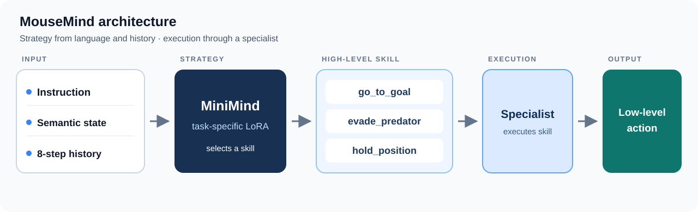

# Method: counterfactual post-training

## Core idea



The diagram shows how verified outcomes train the skill-planner adapter within the hierarchy.

MiniMind decides which skill to use; the specialist decides how to execute it. The main planner follows the **counterfactual supervision → LoRA SFT → verified DPO** training path. DPO starts from a seed-isolated SFT skill-planner adapter and uses a frozen copy of that adapter as its reference, while the MiniMind backbone remains frozen.

At inference, the planner emits one of three constrained JSON skill responses. A continuous BC specialist executes GO as an `(x, y)` destination, while task-specific controllers handle EVADE and HOLD. This interface separates strategic decisions from geometric movement.

## Why hierarchy?

One-step action imitation does not directly optimize closed-loop outcomes. The hierarchy separates semantic and temporal skill selection from movement execution. Counterfactual supervision lets the planner learn from the measured consequences of alternative skills, while low-level controllers handle movement execution.

## Data and supervision

```text
118,861 simulator transitions → strict validation → 4,916 reconstructed episodes
                             → episode-isolated train/val/test splits
                             → serialized-prompt deduplication
```

The source trajectories are a legacy BotEvade simulator-policy export. The goal specialist learns from these trajectories; high-level targets come from verified, exactly replayable anchor states. For each preference, the pipeline executes candidate skills from the same state, scores their short-horizon outcomes, and builds SFT targets and chosen/rejected preference pairs.

The planner-training collection contains **320 anchors** and **1,920 verified counterfactual branches** at horizons **4 and 8**. The DPO study regroups anchors by collection seed and retrains its SFT initialization on the same **1,072 chosen responses** used for preference training. See the [technical guide](technical-guide.md) for observation contracts and the [DPO report](../results/verified-dpo.md) for the controlled training comparison.

## Engineering contributions

- Exact-state counterfactual branching for outcome-based SFT labels and preference pairs.
- Seed-isolated LoRA SFT/DPO with the SFT adapter retained as the frozen DPO reference.
- Semantic state, eight-step history, and constrained three-skill JSON decoding.
- A modular continuous goal executor that preserves the trained planner interface.
- Frozen evaluation contracts, paired seeds, checkpoint hashes, and reset/replay checks.
- Slurm execution with hardware provenance, resource measurements, and private artifact handling.

## Limitations and retained findings

- The latest result covers fixed checkpoints in one simulator world; cross-map and training-seed generalization remain unmeasured for this executor.
- The continuous hierarchy trades higher capture-free completion for more captures per episode than direct BC.
- The historical numeric planner was stronger on capture-free success and captures under the historical contract. It was not evaluated in the latest final200 comparison.
- The three-skill vocabulary and low-level controllers are task-specific. Historical unseen-language and transfer evaluations expose substantial weaknesses.
- Full-parameter DPO, GRPO, longer LoRA DPO, and a corrective hard-example iteration did not improve their respective closed-loop comparisons. The newer continuous-context SFT/DPO candidates collapsed to HOLD and were rejected; the successful system keeps the earlier DPO planner.

The failed candidates are retained in the [continuous experiment report](../archive/continuous-pilot-20261102.md), [Verified RLVR summary](../results/verified-rlvr.md), and [P2 results](../results/planner-benchmarks.md). They are not part of the successful final checkpoint.
